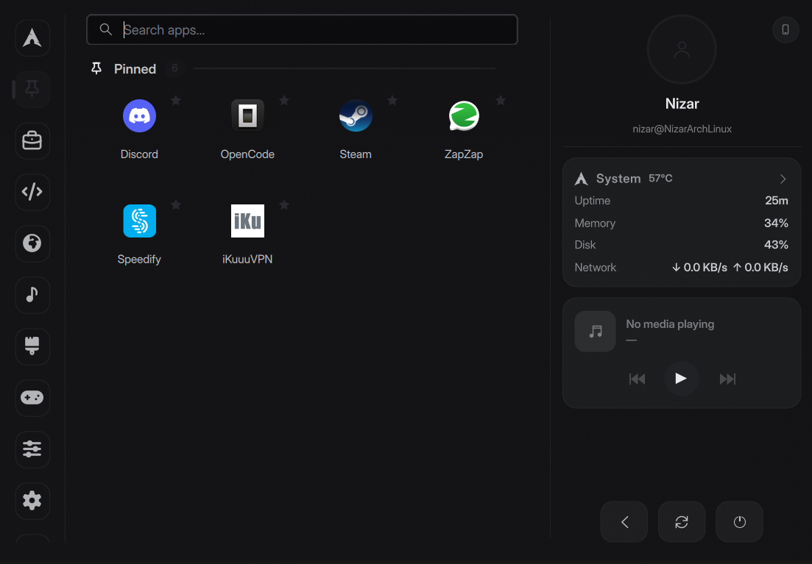
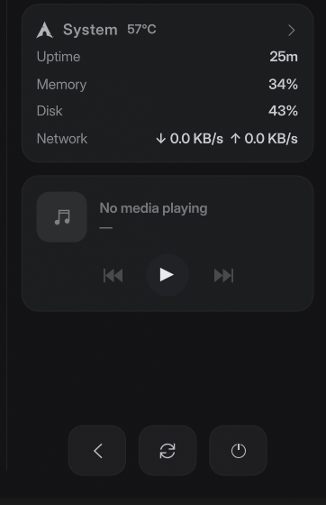

<div align="center">

# Custom Start Menu

**A fast, keyboard-first app dashboard for KDE Plasma 6.**

Search, pinned & recent apps, categories, drag-and-drop, a phone panel,
system & media cards and power controls — all in one popup.


[](metadata.json)



</div>

## ✨ Features

- 🔍 **Instant search** — multi-word matching across name, GenericName,
  keywords, command and category. The first result is selected for you, so
  **Enter** launches it.
- 📌 **Pinned apps** — press and hold a tile to drag & reorder it; the order is
  saved to your Plasma favourites (`klauncherrc`).
- 🕘 **Recently used** — its own rail category, remembering your last launches
  across sessions.
- 🗂️ **Category rail** — All Apps, Pinned, Recently Used and every menu
  category, one click away, with bundled SVG icons.
- 🖱️ **Tile context menu** — right-click any app to launch it, pin/unpin it,
  open its containing folder, or copy its command.
- 🧲 **Drag & drop** — drag any app out of the menu onto the taskbar, the
  desktop or another window (native KDE application drag), or drag it inside
  the Pinned grid to reorder with a live Kickoff-style shuffle.
- 📱 **Phone panel** — KDE Connect control: battery, ring, ping, send files,
  clipboard, browse storage, notifications, a virtual touchpad, send-a-link and
  type-on-phone inputs, and phone media controls.
- 📊 **System card** — uptime, memory, disk and network at a glance; click for
  the full detail view (per-core CPU/GPU, temperatures, swap, battery…).
- 🎵 **Media card** — MPRIS controls and album art for whatever is playing;
  click the art to raise the player.
- ⏻ **Power buttons** — log out, reboot and shut down, each with a yes/no
  confirmation.
- 🪶 **Light on CPU** — the system poll is paused/slowed while the menu is
  closed and the app scan is cached, so an idle desktop stays quiet.

## 🆕 What's new

- **Recently Used** category that tracks your last launches (`~/.local/state/custom-start-menu/recent`).
- **Right-click context menu** on every tile: Launch · Pin/Unpin · Open Containing Folder · Copy Command.
- **`Tab` / `Shift+Tab`** to cycle categories and **`PageUp` / `PageDown`** to page through apps.
- **Lower idle cost** — the 1.5 s system poll drops to a slow idle tick when the popup is closed, and the app scan is cached.
- **Cleaner codebase** — `AppsTab.qml` split into `AppTile.qml`, `PhonePanel.qml` and `SystemDetails.qml` (3184 → ~1870 lines).
- **No more layout warning** — the phone toast is an overlay instead of a `ColumnLayout` child.

## ⌨️ Keyboard

| Key | Action |
| --- | :- |
| type | search apps instantly |
| `↑` `↓` `←` `→` · `Home` `End` | move the selection across the grid |
| `Tab` / `Shift+Tab` | switch to the next / previous category |
| `PageUp` / `PageDown` | jump a screenful of apps |
| `Enter` | launch the selected app — or confirm a power action |
| `Esc` | clear the selection → close the menu |

## 📦 Install

**One command** (fresh Arch + KDE):

```bash
curl -fsSL https://raw.githubusercontent.com/nizar2004/MyCustomStartMenu/main/install.sh | bash
```

**From a clone:**

```bash
git clone https://github.com/nizar2004/MyCustomStartMenu.git
cd MyCustomStartMenu && ./install.sh
```

Then add it to your panel: **right-click the panel → Add Widgets → Custom Start Menu**.

## ⚙️ Customize



Right-click the widget → **Configure…** to change the panel icon, accent colour,
default category, refresh interval and which cards are shown.

**Requirements** — KDE Plasma 6, `systemd`, `glib2`. Optional: `lspci` for the GPU
line, `kdeconnect` for the phone panel. No root needed, it installs per user.

**Uninstall:**

```bash
rm -rf ~/.local/share/plasma/plasmoids/com.nizar.dashboard
systemctl --user restart plasma-plasmashell.service
```

<br clear="right">

## 🗂️ Project layout

```
contents/
├── code/          helper scripts (executable data engine)
│   ├── scanapps.sh    desktop-file scanner
│   ├── sysmon.sh      CPU / RAM / disk / network
│   ├── sysinfo.sh     static system info
│   ├── launchapp.sh   Kickoff-style launching via systemd-run
│   ├── recent.sh      recently-used history
│   ├── phone.sh       KDE Connect bridge
│   └── readfavs.sh / osid.sh
├── ui/
│   ├── main.qml         PlasmoidItem, panel button, popup lifecycle
│   ├── AppsTab.qml      rail + app grid + search + selection
│   ├── AppTile.qml      one application tile (drag, menu, pin)
│   ├── PhonePanel.qml   KDE Connect panel
│   ├── SystemDetails.qml  detailed system view
│   └── DashState.qml    shared singleton state
└── icons/         distro logos and category SVGs
```

## 📄 License

GPL-3.0 — see [metadata.json](metadata.json).
